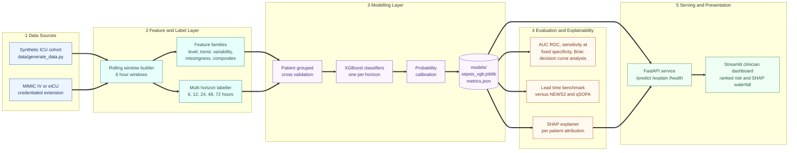
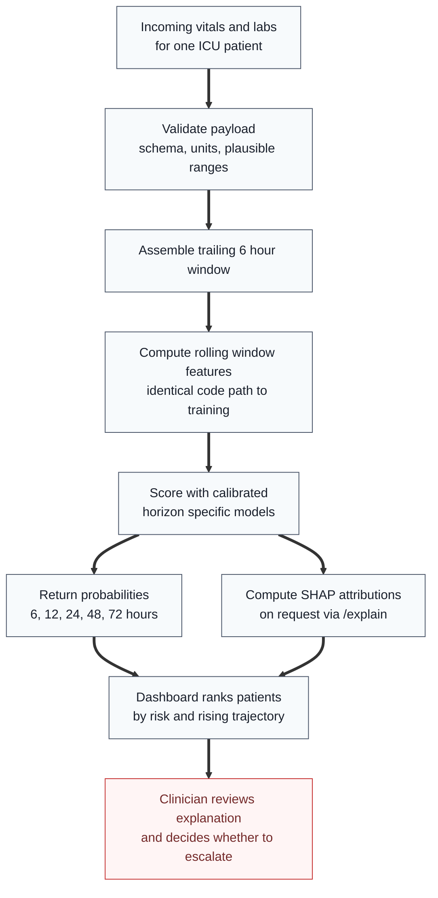
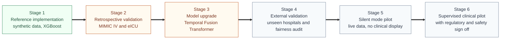

<div align="center">

# 72 Hour Sepsis Onset Prediction from ICU Time Series Streams

**A multi horizon clinical early warning system that estimates the probability of sepsis onset at 6, 12, 24, 48 and 72 hours ahead from rolling windows of ICU vital signs and laboratory results, engineered to deliver more lead time than NEWS2 and qSOFA style track and trigger scoring.**

[](https://www.python.org/)
[](https://xgboost.readthedocs.io/)
[](https://shap.readthedocs.io/)
[](https://fastapi.tiangolo.com/)
[](https://streamlit.io/)
[](LICENSE)
[](#knownlimitationsandpathtoproduction)

</div>

***

> **Reference implementation notice.** The portfolio briefing specifies a Temporal Fusion Transformer trained on MIMIC IV. This repository ships a lightweight and fully runnable XGBoost reference implementation trained on rolling window features drawn from a synthetic, MIMIC IV shaped ICU cohort. No PhysioNet data use agreement is needed to run it, and the complete pipeline, from data generation through feature engineering, training, evaluation, explainability and a live API, runs on an ordinary laptop in under a minute. Replacing the synthetic cohort with real MIMIC IV or eICU data, and replacing the gradient boosted baseline with a PyTorch Temporal Fusion Transformer, is a drop in extension documented in [`docs/EXTENDING.md`](docs/EXTENDING.md).

> **Clinical safety notice.** This software is not a medical device, has not been clinically validated, and must not be used to inform the care of real patients. Every performance figure it produces is computed on synthetic data.

***

<a id="tableofcontents"></a>

## Table of Contents

1. [Project Brief](#projectbrief)
2. [Clinical and Business Value](#clinicalandbusinessvalue)
3. [System Architecture](#systemarchitecture)
4. [Quick Start](#quickstart)
5. [Repository Structure](#repositorystructure)
6. [Data Layer](#datalayer)
7. [Prediction Task and Label Design](#predictiontaskandlabeldesign)
8. [Feature Engineering](#featureengineering)
9. [Model Training](#modeltraining)
10. [Evaluation Methodology](#evaluationmethodology)
11. [Benchmarking Against Track and Trigger Scores](#benchmarkingagainsttrackandtriggerscores)
12. [Explainability](#explainability)
13. [Serving Layer and API Reference](#servinglayerandapireference)
14. [Clinician Dashboard](#cliniciandashboard)
15. [Testing and Reproducibility](#testingandreproducibility)
16. [Model Card Summary](#modelcardsummary)
17. [Governance, Safety and Regulatory Considerations](#governancesafetyandregulatoryconsiderations)
18. [Known Limitations and Path to Production](#knownlimitationsandpathtoproduction)
19. [Roadmap](#roadmap)
20. [References](#references)
21. [License](#license)

***

<a id="projectbrief"></a>

## Project Brief

Sepsis is a time critical medical emergency in which the body's response to an infection begins to injure its own tissues and organs. Under the Sepsis 3 consensus definition it is life threatening organ dysfunction caused by a dysregulated host response to infection, and it remains one of the leading causes of death in intensive care units worldwide. What makes sepsis so dangerous is not only its severity but its pace: a patient can move from subtle and easily overlooked physiological changes, such as a gently climbing heart rate, a slowly widening respiratory rate or a creeping lactate, to septic shock and multiple organ failure over a period of hours rather than days. The clinical problem is therefore not diagnosing sepsis once it is obvious, because by then almost any clinician or bedside score will recognise it. The problem is recognising the trajectory toward sepsis early enough for a care team to act before the patient deteriorates.

Hospitals already have tools for this. The National Early Warning Score 2 (NEWS2), mandated across much of the NHS, and the quick Sequential Organ Failure Assessment (qSOFA) are both track and trigger scores: a handful of bedside observations is compared against fixed thresholds, points are added up, and an escalation is triggered once the total crosses a cut off. These scores are valuable precisely because they are simple enough to calculate with a pen at the bedside. That same simplicity is also their ceiling. They look at one moment in time, they treat each variable independently, and they ignore laboratory trends altogether, so they are structurally blind to the slow, multivariate drift that frequently precedes sepsis. By the time enough individual thresholds are breached to fire an alert, much of the window in which early intervention would have helped may already be gone.

This project is built to close that recognition gap. It continuously scores every ICU patient from the data the unit is already collecting, using rolling six hour windows of vitals and labs, and returns a calibrated probability of sepsis onset at five lookahead horizons: 6, 12, 24, 48 and 72 hours. The multi horizon design gives a care team two different kinds of signal at once. The short horizons answer the urgent question of who needs review now, while the long horizons surface patients on a worrying trajectory who look stable today but may not be by tomorrow. Every score is accompanied by a SHAP based explanation of which physiological trends pushed it up or down, served through a FastAPI service and a clinician facing Streamlit dashboard, so the model's reasoning stays inspectable at the point of care rather than hidden behind a bare number.

***

<a id="clinicalandbusinessvalue"></a>

## Clinical and Business Value

### Lead time is the metric that matters

The single most important clinical fact behind this project is that delay kills in sepsis. In a landmark retrospective study of patients with septic shock, Kumar and colleagues (2006) reported that each hour of delay in starting effective antimicrobial therapy after the onset of hypotension was associated with a measurable fall in survival. Later work across large hospital networks has reinforced the broader principle that faster recognition and treatment is associated with better outcomes. A sepsis prediction system should therefore not be judged mainly on whether it can eventually recognise sepsis, since florid septic shock is easy to recognise. It should be judged on how many extra hours of warning it gives a team over the tools already in routine use, because those hours are where outcomes are won or lost.

That is why the stated objective of this repository is to outperform NEWS2 and qSOFA style scoring on **lead time at a matched alert burden**, rather than on a headline accuracy figure alone. A model that matches NEWS2 on accuracy but alerts four hours earlier is clinically far more valuable than one that beats it on AUC ROC while alerting at the same moment.

### Why this is a business problem as well as a clinical one

Sepsis accounts for a share of inpatient mortality and inpatient cost that is out of proportion to its prevalence. The cost is driven by prolonged ICU stays, escalation to higher acuity care, organ support such as vasopressors, ventilation and renal replacement therapy, and long and complicated recoveries. Every hour of delayed recognition therefore carries two linked costs: a clinical cost to the patient and a financial cost to the health system in additional bed days and interventions. A hospital evaluating a system like this one is answering two questions together. Does earlier recognition improve outcomes, and does it shorten the acute, resource intensive phase of the illness? Both answers point the same way, which is part of why sepsis early warning is among the most commercially mature use cases for predictive analytics in acute care.

### Illustrative unit economics

The figures below are an illustrative reasoning model built from explicitly stated assumptions. They show the shape of the business case a hospital system would build before a pilot. They are **not** measured results and must not be read as claims about this model's real world performance.

<table>
  <thead>
    <tr>
      <th align="left">Quantity</th>
      <th align="left">Illustrative value</th>
      <th align="left">Basis</th>
    </tr>
  </thead>
  <tbody>
    <tr>
      <td>Annual ICU admissions at a mid sized hospital system</td>
      <td>12,000</td>
      <td>Assumption</td>
    </tr>
    <tr>
      <td>Share of ICU admissions developing sepsis during their stay</td>
      <td>10 percent, or 1,200 cases per year</td>
      <td>Assumption</td>
    </tr>
    <tr>
      <td>Additional ICU cost of a late recognised case versus an early recognised case</td>
      <td>$8,000 per case</td>
      <td>Illustrative</td>
    </tr>
    <tr>
      <td>Share of cases where model driven recognition plausibly converts a late recognition into an early one</td>
      <td>20 percent, or 240 cases per year</td>
      <td>Illustrative, pending pilot validation</td>
    </tr>
    <tr>
      <td><strong>Illustrative annual cost avoidance</strong> (240 cases multiplied by $8,000)</td>
      <td><strong>$1,920,000 per year</strong></td>
      <td>Derived</td>
    </tr>
  </tbody>
</table>

A credible business case would also net off the costs that an early warning system introduces: integration and maintenance, clinician time spent reviewing alerts, and the downstream cost of false positives such as additional blood cultures and unnecessary antibiotic exposure. A real pilot must measure local sepsis incidence, current time to recognition, cost per case and alert workload at a specific institution before any of these numbers can be relied on.

### Why a synthetic XGBoost baseline comes before a real data transformer

MIMIC IV is the right eventual data source and the Temporal Fusion Transformer is a strong eventual architecture, but both are the wrong starting point for a reference implementation that anyone should be able to clone and run. MIMIC IV requires credentialed PhysioNet access and a signed data use agreement, which would stop most reviewers from ever seeing the pipeline work. This repository instead ships a synthetic cohort with the same structural shape as MIMIC IV and a gradient boosted model over engineered rolling window features. The trade off is stated openly: gradient boosted trees are fast, interpretable, well calibrated after post processing and easy to reproduce, but they are not expected to match the sequence modelling capacity of a well trained transformer over real, high resolution ICU telemetry. The architecture is deliberately modular so that both the data source and the model can be upgraded without rewriting the surrounding pipeline.

***

<a id="systemarchitecture"></a>

## System Architecture

The system is organised into five layers. Each layer has a single responsibility and communicates with the next through a stable interface, which is what allows the data source and the model to be swapped independently.



### Inference lifecycle

The diagram below follows a single scoring request from the bedside data stream to the clinician.



The final step is deliberately a human decision. The model informs clinical judgement; it never replaces it, and it never triggers treatment on its own.

***

<a id="quickstart"></a>

## Quick Start

### Requirements

* Python 3.9 or newer
* Roughly 500 MB of free disk space for the virtual environment and generated data
* No GPU, no cloud account and no credentialed data access

### Installation and full pipeline run

```bash
python3 -m venv .venv
source .venv/bin/activate
pip install -r requirements.txt

python data/generate_data.py          # builds data/icu_stays.csv (synthetic cohort)
python src/train.py                   # trains the models and writes models/sepsis_xgb.joblib
python src/evaluate.py                # writes models/metrics.json and the decision curve plot
python src/explain.py                 # produces a SHAP contributing factors report
```

### Launching the services

```bash
uvicorn serving.api:app               # REST API on http://127.0.0.1:8000
streamlit run dashboard/app.py        # clinician dashboard on http://localhost:8501
```

Interactive API documentation is generated automatically by FastAPI at `http://127.0.0.1:8000/docs`.

### Running the tests

```bash
pytest tests
```

***

<a id="repositorystructure"></a>

## Repository Structure

```text
.
├── data/
│   ├── generate_data.py        Synthetic MIMIC IV shaped cohort generator
│   └── icu_stays.csv           Generated dataset, approximately 50,000 windows
├── src/
│   ├── features.py             Rolling window feature engineering (6 hour windows)
│   ├── train.py                Patient grouped training of the XGBoost classifiers
│   ├── evaluate.py             AUC ROC, sensitivity at fixed specificity, Brier, decision curve
│   └── explain.py              SHAP contributing factors per prediction
├── serving/
│   └── api.py                  FastAPI service exposing /predict, /explain and /health
├── dashboard/
│   └── app.py                  Streamlit clinician dashboard with SHAP waterfall view
├── models/
│   ├── sepsis_xgb.joblib       Trained model artifact
│   └── metrics.json            Evaluation metrics, checked in for transparency
├── notebooks/
│   └── eda.ipynb               Exploratory data analysis of the synthetic cohort
├── tests/
│   └── test_pipeline.py        Sanity tests across data, training and prediction
├── docs/
│   ├── MODEL_CARD.md           Intended use, limitations and fairness audit checklist
│   └── EXTENDING.md            Migration path to MIMIC IV, eICU and a Temporal Fusion Transformer
├── requirements.txt
├── LICENSE
└── README.md
```

***

<a id="datalayer"></a>

## Data Layer

### Synthetic cohort

`data/generate_data.py` produces a synthetic cohort shaped to resemble the structure of MIMIC IV ICU stays. Each simulated stay contains:

<table>
  <thead>
    <tr>
      <th align="left">Signal group</th>
      <th align="left">Examples</th>
      <th align="left">Clinical relevance</th>
    </tr>
  </thead>
  <tbody>
    <tr>
      <td>Vital signs</td>
      <td>Heart rate, respiratory rate, systolic and mean arterial pressure, temperature, oxygen saturation</td>
      <td>Core inputs to NEWS2 and qSOFA and the earliest markers of systemic inflammatory response</td>
    </tr>
    <tr>
      <td>Laboratory results</td>
      <td>White blood cell count, lactate, and related markers of organ function</td>
      <td>Lactate reflects tissue hypoperfusion; white cell count reflects the inflammatory response</td>
    </tr>
    <tr>
      <td>Outcome</td>
      <td>Sepsis onset label anchored to a specific time point in each septic stay</td>
      <td>Defines the target event that every prediction horizon is measured against</td>
    </tr>
  </tbody>
</table>

The generator is designed to reproduce the properties that make real ICU data difficult, not just its column layout. Vitals are sampled frequently and labs sparsely, so missingness is informative rather than random. Septic stays drift gradually toward abnormal physiology before onset rather than jumping abruptly, which is the very pattern the model must learn to detect early. Non septic stays include their own noise and transient abnormalities, so the model cannot succeed by flagging every abnormal reading.

### Why synthetic data first

Synthetic data can be regenerated at will, shared freely without a data use agreement, and used to prove that every stage of the pipeline behaves correctly before credentialed clinical data is introduced. It also allows the pipeline to be tested against a known ground truth: because the generator controls exactly when and how deterioration begins, it is possible to check that the model's lead time behaves sensibly. The obvious cost is that synthetic data cannot validate clinical performance, which is stated plainly in every section where it matters.

### Real data extension

The migration to MIMIC IV or eICU is documented in [`docs/EXTENDING.md`](docs/EXTENDING.md). In a real data setting, the sepsis onset label would be derived using the Sepsis 3 operationalisation: suspected infection, identified from the timing of antibiotic administration and body fluid culture orders, combined with an acute increase of two or more points in the SOFA score.

***

<a id="predictiontaskandlabeldesign"></a>

## Prediction Task and Label Design

### Formal task

For every patient and every scoring time *t*, the model receives only the data observed in the trailing six hour window ending at *t*. For each horizon *h* in {6, 12, 24, 48, 72} hours it estimates:

```text
P( sepsis onset occurs in the interval (t, t + h]  |  observations up to and including t )
```

### Window and label timeline

```text
   ICU admission                       scoring time t                                 sepsis onset
        │                                     │                                             │
        ├───────────── history ───────────────┤                                             │
        │                 ┌──── 6 hour window ┤                                             │
        │                 │  features built   │                                             │
        │                 │  from this span   │                                             │
        │                 └───────────────────┤                                             │
        │                                     ├── 6 h ──┤                                   │
        │                                     ├──── 12 h ─────┤                             │
        │                                     ├──────── 24 h ────────────┤                  │
        │                                     ├──────────── 48 h ───────────────────────────┼─┤  positive
        │                                     ├──────────────── 72 h ───────────────────────┼─────────┤  positive
```

In the example above, onset falls inside the 48 and 72 hour horizons but outside the 6, 12 and 24 hour horizons, so this single window carries a positive label for the two longest horizons and a negative label for the three shortest.

### Leakage controls built into the label design

* **Strictly causal features.** Every feature at time *t* is computed only from observations timestamped at or before *t*. No future value, including a lab result that was drawn earlier but reported later, may enter the window.
* **Censoring after onset.** Windows that end after sepsis onset are excluded from training and evaluation. Predicting sepsis that has already happened is trivially easy and would inflate every metric.
* **Patient level separation.** All windows from a single stay are kept in the same cross validation fold, as described in [Model Training](#modeltraining).

***

<a id="featureengineering"></a>

## Feature Engineering

`src/features.py` converts the raw, irregular vitals and labs stream into a fixed length feature vector for every six hour window. The core principle is that a single reading is noisy and can mislead on its own, while a short rolling trend, such as a steadily rising heart rate combined with a falling blood pressure, is a far stronger signal of physiological deterioration.

<table>
  <thead>
    <tr>
      <th align="left">Feature family</th>
      <th align="left">What it captures</th>
      <th align="left">Why it matters for sepsis</th>
    </tr>
  </thead>
  <tbody>
    <tr>
      <td>Level</td>
      <td>Last observed value, window mean, minimum and maximum</td>
      <td>Absolute derangement such as hypotension, tachycardia or hyperlactataemia</td>
    </tr>
    <tr>
      <td>Trend</td>
      <td>Change across the window and linear slope over time</td>
      <td>Gradual drift that precedes threshold breaches is the main source of extra lead time</td>
    </tr>
    <tr>
      <td>Variability</td>
      <td>Standard deviation and range within the window</td>
      <td>Physiological instability and loss of normal regulation</td>
    </tr>
    <tr>
      <td>Measurement process</td>
      <td>Missingness indicators, observation counts and time since last measurement</td>
      <td>Clinicians order tests more often when they are worried, so measurement frequency is itself informative</td>
    </tr>
    <tr>
      <td>Clinical composites</td>
      <td>Derived ratios such as shock index (heart rate divided by systolic blood pressure)</td>
      <td>Combines two weak signals into one that tracks haemodynamic compromise more closely</td>
    </tr>
  </tbody>
</table>

Missing values are never silently imputed with population averages in a way that hides their absence. Gradient boosted trees handle missing inputs natively, and the explicit missingness indicators preserve the information carried by the fact that a test was or was not ordered. The same `features.py` code path is used at training time and at serving time, which removes an entire class of training versus serving skew.

***

<a id="modeltraining"></a>

## Model Training

### Algorithm

`src/train.py` trains XGBoost classifiers over the engineered rolling window features, one per prediction horizon. Gradient boosted trees are a deliberate choice for the reference implementation:

* They are strong on tabular, heterogeneous clinical features with mixed scales.
* They handle missing values natively, which suits sparse laboratory data.
* They train in seconds on a laptop, which keeps the whole repository fast to reproduce.
* They pair naturally with exact TreeSHAP explanations, which matter for clinical trust.

### Patient grouped cross validation

Training uses patient grouped cross validation, so windows from the same ICU stay never appear in both a training fold and a validation fold. Consecutive windows from one stay are strongly correlated with each other. A naive random split would let the model partly memorise an individual patient's trajectory rather than learn a pattern that generalises, producing an evaluation score that flatters the model compared with its performance on a genuinely new patient. Grouping by patient is the single most important safeguard against that optimism.

### Class imbalance

Sepsis onset windows are a minority of all windows, and positives become rarer as the horizon shortens. Imbalance is handled through class weighting during training rather than resampling, which preserves the true base rate in the data the model sees and keeps predicted probabilities interpretable once calibrated.

### Calibration

A clinical score is shown to a human as a number, so the number must mean what it says: among patients assigned a 20 percent risk, roughly 20 percent should go on to develop sepsis within that horizon. Raw boosted tree outputs are often poorly calibrated, so predicted probabilities are calibrated on held out data and the result is checked with the Brier score and reliability analysis in `src/evaluate.py`.

### Artifacts

Training writes the fitted model to `models/sepsis_xgb.joblib`. Evaluation writes `models/metrics.json`, which is checked into the repository so that the reported numbers can be audited against the code that produced them.

***

<a id="evaluationmethodology"></a>

## Evaluation Methodology

`src/evaluate.py` reports a deliberately broad set of metrics, because no single number captures whether a clinical prediction model is worth deploying.

<table>
  <thead>
    <tr>
      <th align="left">Metric</th>
      <th align="left">Question it answers</th>
      <th align="left">Why it is included</th>
    </tr>
  </thead>
  <tbody>
    <tr>
      <td>AUC ROC</td>
      <td>How well does the model rank septic windows above non septic windows?</td>
      <td>The standard summary of discrimination, reported separately for each horizon</td>
    </tr>
    <tr>
      <td>Sensitivity at fixed specificity</td>
      <td>Once the false alarm rate is fixed at a level clinicians can tolerate, how many true cases are caught?</td>
      <td>Mirrors how an alerting system is actually configured on a ward</td>
    </tr>
    <tr>
      <td>Brier score</td>
      <td>How close are the predicted probabilities to the observed outcomes?</td>
      <td>Measures calibration as well as ranking, which matters because the probability itself is shown to clinicians</td>
    </tr>
    <tr>
      <td>Decision curve analysis</td>
      <td>Across plausible decision thresholds, does acting on the model produce more net benefit than treating everyone or treating no one?</td>
      <td>The standard method for judging whether a clinical prediction model is worth acting on, not merely better than chance</td>
    </tr>
  </tbody>
</table>

### Reading the results

All results are written to `models/metrics.json` and the decision curve plot produced by `src/evaluate.py`. Two patterns are expected and should be checked whenever the pipeline is re run. First, discrimination should generally fall as the horizon lengthens, because predicting onset three days ahead is genuinely harder than predicting it six hours ahead. Second, prevalence rises with horizon length, since a longer window contains more onsets, so area under the precision recall curve and positive predictive value must always be read alongside the base rate for that horizon. A result that breaks either pattern is more likely to indicate leakage than a breakthrough.

All figures produced by this repository are computed on synthetic data and say nothing about real world clinical performance.

***

<a id="benchmarkingagainsttrackandtriggerscores"></a>

## Benchmarking Against Track and Trigger Scores

Because the project's purpose is to beat existing bedside scoring on lead time, the comparison protocol matters as much as the model.

### Baselines

<table>
  <thead>
    <tr>
      <th align="left">Score</th>
      <th align="left">Inputs</th>
      <th align="left">Conventional trigger</th>
    </tr>
  </thead>
  <tbody>
    <tr>
      <td>NEWS2</td>
      <td>Respiratory rate, oxygen saturation, supplemental oxygen, systolic blood pressure, pulse, level of consciousness, temperature</td>
      <td>Aggregate score of 5 or more for urgent review; 7 or more for emergency response</td>
    </tr>
    <tr>
      <td>qSOFA</td>
      <td>Respiratory rate of 22 or more, altered mentation, systolic blood pressure of 100 mmHg or less</td>
      <td>2 or more of the 3 criteria present</td>
    </tr>
  </tbody>
</table>

### Comparison protocol

1. **Compute the baselines on the same windows.** NEWS2 and qSOFA are computed from the same observations the model sees, at the same scoring times, so every method has identical information available.
2. **Match the alert burden.** The model's alert threshold is set so that it fires no more often than the baseline score does. Comparing a model at a lower threshold against a baseline at its standard threshold would buy lead time with extra false alarms, which is not a fair comparison.
3. **Measure lead time per septic stay.** For each septic stay, lead time is the time between the first alert and sepsis onset. The median and interquartile range are reported for the model and each baseline.
4. **Report the miss rate alongside lead time.** A method that alerts early on a few patients but misses many others is not better, so the proportion of septic stays with no alert before onset is reported next to the lead time.
5. **Report alert burden directly.** Alerts per patient day are reported, because alarm fatigue is one of the main reasons early warning systems fail in practice.

***

<a id="explainability"></a>

## Explainability

`src/explain.py` uses SHAP to produce a per prediction, per patient contributing factors report. For any single risk score, it shows which specific vital sign and laboratory trends pushed the score up or down, and by how much, relative to the average patient.

This exists for a concrete operational reason. A bedside clinician will not act on a bare probability they cannot interrogate, and a system that cannot explain why it flagged a patient is a system clinicians learn to override or ignore. An explanation such as *risk rose mainly because lactate climbed across the window and the shock index increased, partly offset by a stable temperature* lets the clinician check the reasoning against what they see at the bedside within seconds.

Three properties make SHAP a good fit here:

* **Local fidelity.** Each explanation is specific to one patient at one moment, not a global average.
* **Additivity.** The contributions sum exactly to the difference between the patient's score and the baseline, so nothing is hidden.
* **Exact computation for trees.** TreeSHAP computes exact attributions for gradient boosted trees quickly enough to serve on demand.

Explanations describe what the model relied on, not what causes sepsis. They are an aid to clinical review and auditing, not a causal or diagnostic statement.

***

<a id="servinglayerandapireference"></a>

## Serving Layer and API Reference

`serving/api.py` exposes the trained model through a FastAPI service.

<table>
  <thead>
    <tr>
      <th align="left">Endpoint</th>
      <th align="left">Method</th>
      <th align="left">Purpose</th>
    </tr>
  </thead>
  <tbody>
    <tr>
      <td><code>/predict</code></td>
      <td>POST</td>
      <td>Returns the sepsis onset probability at each of the 6, 12, 24, 48 and 72 hour horizons for a patient window</td>
    </tr>
    <tr>
      <td><code>/explain</code></td>
      <td>POST</td>
      <td>Returns the SHAP contributing factors behind a specific prediction</td>
    </tr>
    <tr>
      <td><code>/health</code></td>
      <td>GET</td>
      <td>Service health check suitable for a container orchestration liveness probe</td>
    </tr>
  </tbody>
</table>

### Example client call

The payload below shows the general shape of a request. The authoritative request and response schemas are defined in `serving/api.py` and published at `/docs` when the service is running.

```python
import requests

payload = {
    "patient_id": "SYN000123",
    "window_end_hour": 36,
    "observations": {
        "heart_rate": [96, 101, 104, 108, 112, 117],
        "resp_rate": [18, 19, 21, 22, 23, 24],
        "sbp": [118, 114, 109, 105, 101, 98],
        "temperature": [37.6, 37.9, 38.1, 38.3, 38.4, 38.6],
        "lactate": [1.4, None, None, 2.1, None, 2.8],
        "wbc": [11.2, None, None, None, None, 14.6]
    }
}

prediction = requests.post("http://127.0.0.1:8000/predict", json=payload).json()
explanation = requests.post("http://127.0.0.1:8000/explain", json=payload).json()
```

### Example response shape

```json
{
  "patient_id": "SYN000123",
  "window_end_hour": 36,
  "risk": {
    "6h": 0.08,
    "12h": 0.14,
    "24h": 0.27,
    "48h": 0.41,
    "72h": 0.52
  },
  "model_version": "xgb_reference"
}
```

The values above are illustrative only and are not output from the shipped model.

### Design principles for the service

* **One feature code path.** The API calls the same feature functions used during training, so the model never sees features computed differently in production.
* **Stateless scoring.** Each request carries the window it needs, which keeps the service horizontally scalable behind a load balancer.
* **Versioned outputs.** Every response names the model version that produced it, so any score shown to a clinician can be traced back to a specific artifact.

***

<a id="cliniciandashboard"></a>

## Clinician Dashboard

`dashboard/app.py` provides a Streamlit view of the same model, designed for a pre rounds or handover workflow rather than for engineers:

* **Ranked patient list.** Current ICU patients ordered by risk and, more importantly, by how quickly that risk is rising, because a patient whose score has doubled in six hours deserves attention even if their absolute risk is still moderate.
* **Multi horizon view.** Short and long horizon risks shown side by side, separating patients who need review now from patients on a concerning trajectory.
* **SHAP waterfall chart.** Available for any patient, showing exactly which trends drove the score so a clinician can check the reasoning before deciding whether to escalate.

The dashboard presents risk and explanation. Escalation remains a clinical decision.

***

<a id="testingandreproducibility"></a>

## Testing and Reproducibility

`tests/test_pipeline.py` provides sanity tests across the data, training and prediction path, including checks that:

* The generated dataset has the expected columns, types and plausible physiological ranges.
* The training pipeline runs end to end and writes a model artifact that can be reloaded.
* Predictions are valid probabilities between 0 and 1 for every horizon.
* No patient appears in both training and validation folds.

Reproducibility is supported by fixed random seeds in data generation and training, pinned dependencies in `requirements.txt`, and a checked in `metrics.json` that lets anyone confirm their run matches the published numbers.

***

<a id="modelcardsummary"></a>

## Model Card Summary

The full model card lives in [`docs/MODEL_CARD.md`](docs/MODEL_CARD.md) and is the authoritative statement of what this model is and is not validated to do. It should be read before the pipeline is adapted for anything beyond demonstration.

<table>
  <thead>
    <tr>
      <th align="left">Field</th>
      <th align="left">Summary</th>
    </tr>
  </thead>
  <tbody>
    <tr>
      <td>Model type</td>
      <td>Gradient boosted tree classifiers (XGBoost), one per horizon, with calibrated outputs</td>
    </tr>
    <tr>
      <td>Intended use</td>
      <td>Demonstration of architecture, methodology and engineering practice for ICU sepsis early warning</td>
    </tr>
    <tr>
      <td>Out of scope use</td>
      <td>Any use that informs the care of real patients; use outside adult ICU settings; autonomous treatment decisions</td>
    </tr>
    <tr>
      <td>Training data</td>
      <td>Synthetic, MIMIC IV shaped ICU cohort of approximately 50,000 windows</td>
    </tr>
    <tr>
      <td>Evaluation</td>
      <td>Patient grouped cross validation; AUC ROC, sensitivity at fixed specificity, Brier score, decision curve analysis</td>
    </tr>
    <tr>
      <td>Fairness</td>
      <td>Audit checklist specified; cannot be meaningfully executed without real, demographically representative data</td>
    </tr>
    <tr>
      <td>Clinical validation</td>
      <td>None</td>
    </tr>
  </tbody>
</table>

### Fairness audit checklist

When moved onto real data, performance and calibration must be reported separately across subgroups including age band, sex, ethnicity, admission type, and the hospital or unit of origin. Particular attention is needed for any input whose measurement is known to vary across groups. Pulse oximetry, for example, has been shown to overestimate oxygen saturation in patients with darker skin, which can propagate silently into any score that relies on it. Differences in how often tests are ordered for different groups can likewise leak into the measurement process features.

***

<a id="governancesafetyandregulatoryconsiderations"></a>

## Governance, Safety and Regulatory Considerations

Any system intended to move beyond reference use would need to address the following before deployment:

* **Medical device regulation.** Software that informs clinical decisions is likely to qualify as software as a medical device, regulated in the United Kingdom by the MHRA, in the United States by the FDA, and in the European Union under the Medical Device Regulation and the AI Act's provisions for high risk systems.
* **NHS clinical safety standards.** Deployment in an NHS setting would require compliance with DCB0129, which governs the manufacturer's clinical risk management, and DCB0160, which governs the deploying organisation's clinical risk management, including a hazard log and a named clinical safety officer.
* **Data protection.** Processing identifiable patient data requires a lawful basis under UK GDPR and a data protection impact assessment.
* **Alert fatigue.** Early warning systems that generate too many low value alerts are routinely ignored. Alert thresholds must be agreed with clinicians and alert burden monitored continuously after go live.
* **Silent mode validation.** Before any score is shown to clinicians, the system should run silently alongside usual care so that its real world lead time, miss rate and alert burden can be measured without affecting patients.
* **Drift monitoring.** Changes in patient mix, measurement equipment, documentation practice or treatment protocols can degrade a model over time. Input distributions, calibration and alert rates must be monitored with defined thresholds for retraining or withdrawal.

***

<a id="knownlimitationsandpathtoproduction"></a>

## Known Limitations and Path to Production

### Known limitations

* **Synthetic training data.** The cohort is generated to resemble the structure of MIMIC IV rather than drawn from real patients. No figure produced by this repository is a claim about real world clinical performance.
* **A gradient boosted baseline, not the specified transformer.** XGBoost over hand engineered rolling window features is fast, interpretable and reproducible, but it is not expected to match a well trained Temporal Fusion Transformer over real, high resolution ICU telemetry.
* **Fixed six hour context.** Each prediction sees only the trailing six hours. Longer range context, such as a deterioration that began a day earlier, is captured only partially by the trend features.
* **Label definition.** The synthetic onset label is a controlled simplification. Real world sepsis onset labels derived from Sepsis 3 criteria are noisy and depend on documentation and ordering practice.
* **No clinical validation.** The system has not been evaluated against real patient outcomes, has not undergone regulatory review, and is not a certified medical device.
* **Fairness audit not executed.** The checklist exists, but it cannot be meaningfully completed on synthetic data.

### Path to production



<table>
  <thead>
    <tr>
      <th align="left">Stage</th>
      <th align="left">Goal</th>
      <th align="left">Exit criterion</th>
    </tr>
  </thead>
  <tbody>
    <tr>
      <td>1 Reference implementation</td>
      <td>Prove the full pipeline end to end</td>
      <td>Complete; reproducible on a laptop</td>
    </tr>
    <tr>
      <td>2 Retrospective validation</td>
      <td>Replace synthetic data with MIMIC IV and eICU using Sepsis 3 labels</td>
      <td>Lead time beats NEWS2 and qSOFA at matched alert burden</td>
    </tr>
    <tr>
      <td>3 Model upgrade</td>
      <td>Introduce a Temporal Fusion Transformer over longer context</td>
      <td>Improvement over the XGBoost baseline on the same data and protocol</td>
    </tr>
    <tr>
      <td>4 External validation</td>
      <td>Test on hospitals never seen in training and complete the fairness audit</td>
      <td>Performance and calibration hold across sites and subgroups</td>
    </tr>
    <tr>
      <td>5 Silent mode pilot</td>
      <td>Score live patients without showing results to clinicians</td>
      <td>Acceptable real world lead time, miss rate and alert burden</td>
    </tr>
    <tr>
      <td>6 Supervised clinical pilot</td>
      <td>Display scores to clinicians under governance</td>
      <td>Regulatory clearance and clinical safety sign off</td>
    </tr>
  </tbody>
</table>

***

<a id="roadmap"></a>

## Roadmap

* Automated NEWS2 and qSOFA baseline computation and lead time reporting inside `src/evaluate.py`
* Precision recall curves and alerts per patient day reported alongside the existing metrics
* A data loader for MIMIC IV and eICU with a Sepsis 3 onset labeller
* A PyTorch Temporal Fusion Transformer with attention based interpretability, benchmarked against the XGBoost baseline under the identical protocol
* Containerisation and a continuous integration workflow that runs the test suite on every change
* Drift and calibration monitoring hooks in the serving layer
* HL7 FHIR compatible input adapters for integration with electronic health record systems

***

<a id="references"></a>

## References

1. Singer M, Deutschman CS, Seymour CW, et al. The Third International Consensus Definitions for Sepsis and Septic Shock (Sepsis 3). *JAMA*. 2016;315(8):801 to 810.
2. Kumar A, Roberts D, Wood KE, et al. Duration of hypotension before initiation of effective antimicrobial therapy is the critical determinant of survival in human septic shock. *Critical Care Medicine*. 2006;34(6):1589 to 1596.
3. Royal College of Physicians. *National Early Warning Score (NEWS) 2: Standardising the assessment of acute illness severity in the NHS*. London: RCP; 2017.
4. Seymour CW, Liu VX, Iwashyna TJ, et al. Assessment of Clinical Criteria for Sepsis. *JAMA*. 2016;315(8):762 to 774.
5. Johnson AEW, Bulgarelli L, Shen L, et al. MIMIC IV, a freely accessible electronic health record dataset. *Scientific Data*. 2023;10:1.
6. Pollard TJ, Johnson AEW, Raffa JD, et al. The eICU Collaborative Research Database, a freely available multi center database for critical care research. *Scientific Data*. 2018;5:180178.
7. Reyna MA, Josef CS, Jeter R, et al. Early Prediction of Sepsis From Clinical Data: The PhysioNet/Computing in Cardiology Challenge 2019. *Critical Care Medicine*. 2020;48(2):210 to 217.
8. Lim B, Arık SÖ, Loeff N, Pfister T. Temporal Fusion Transformers for interpretable multi horizon time series forecasting. *International Journal of Forecasting*. 2021;37(4):1748 to 1764.
9. Chen T, Guestrin C. XGBoost: A Scalable Tree Boosting System. *Proceedings of the 22nd ACM SIGKDD International Conference on Knowledge Discovery and Data Mining*. 2016.
10. Lundberg SM, Lee SI. A Unified Approach to Interpreting Model Predictions. *Advances in Neural Information Processing Systems*. 2017.
11. Vickers AJ, Elkin EB. Decision curve analysis: a novel method for evaluating prediction models. *Medical Decision Making*. 2006;26(6):565 to 574.
12. Sjoding MW, Dickson RP, Iwashyna TJ, Gay SE, Valley TS. Racial Bias in Pulse Oximetry Measurement. *New England Journal of Medicine*. 2020;383:2477 to 2478.

***

<a id="license"></a>

## License

Distributed under the MIT License for portfolio and demonstration use. See [`LICENSE`](LICENSE) for the full text. This software is not a certified medical device and is not intended for clinical deployment without regulatory review.
